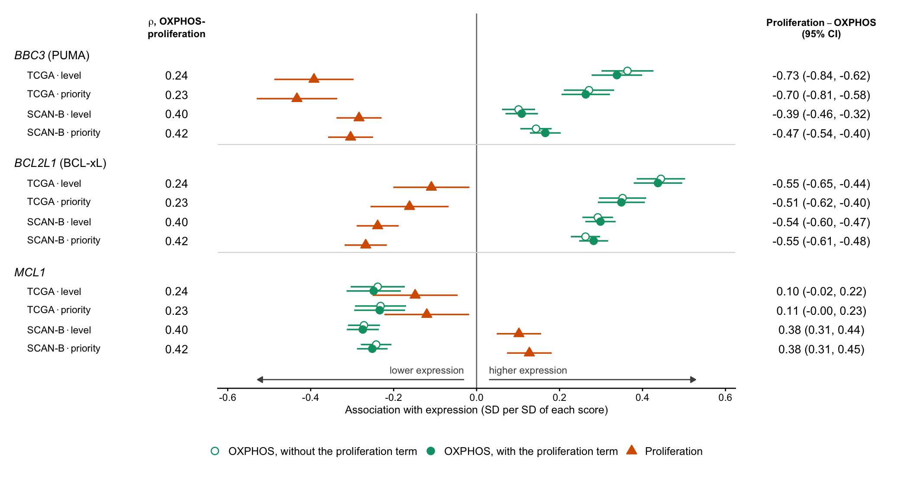
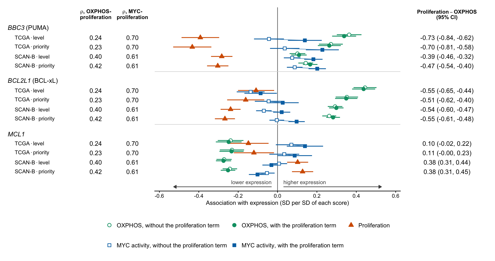
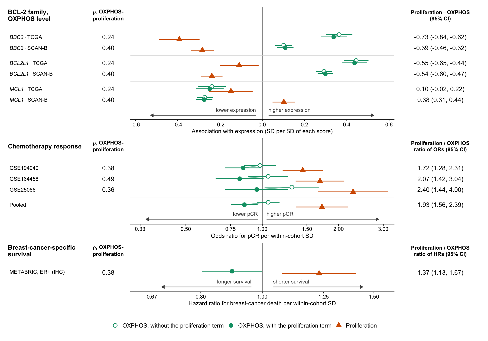
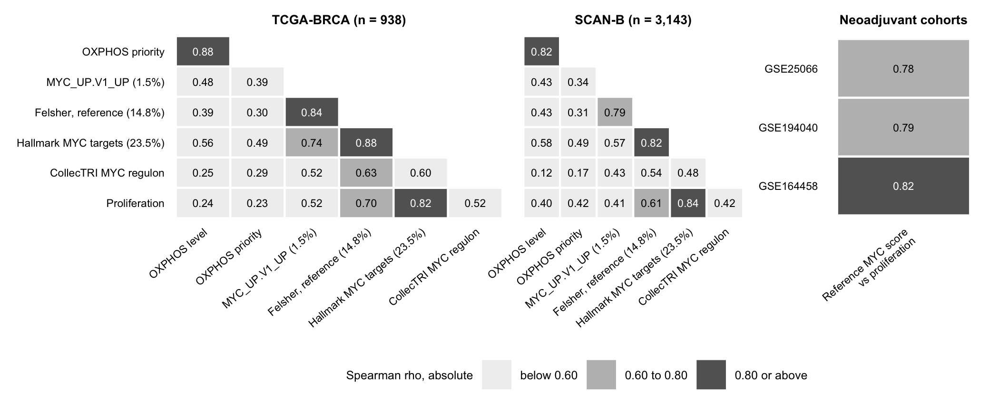
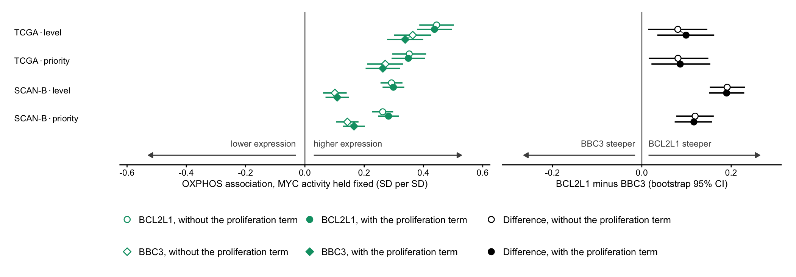
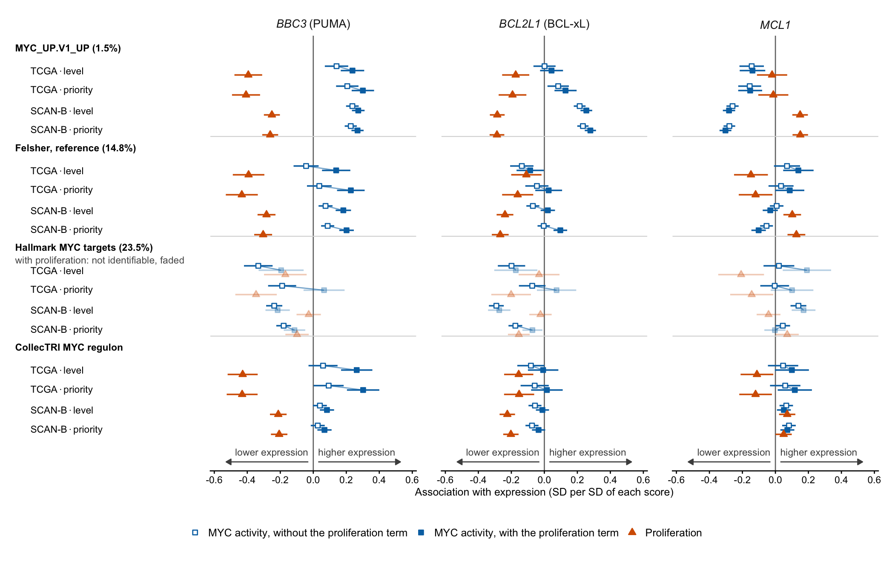
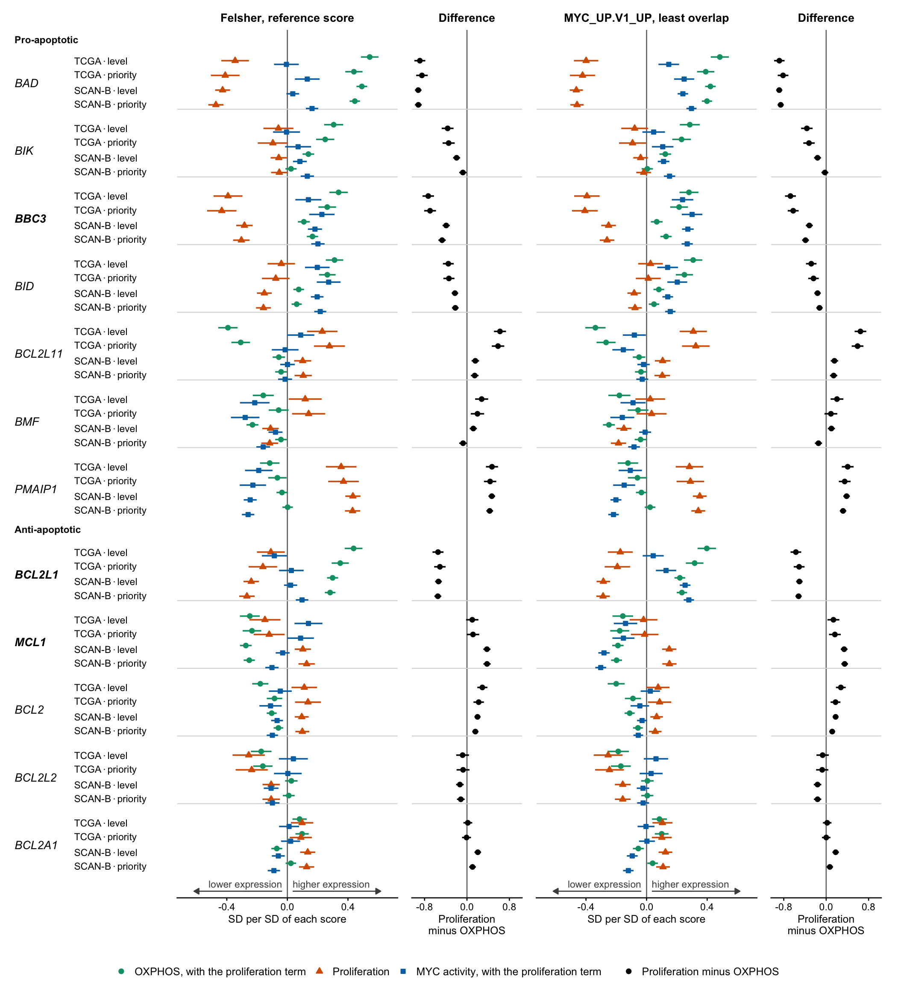
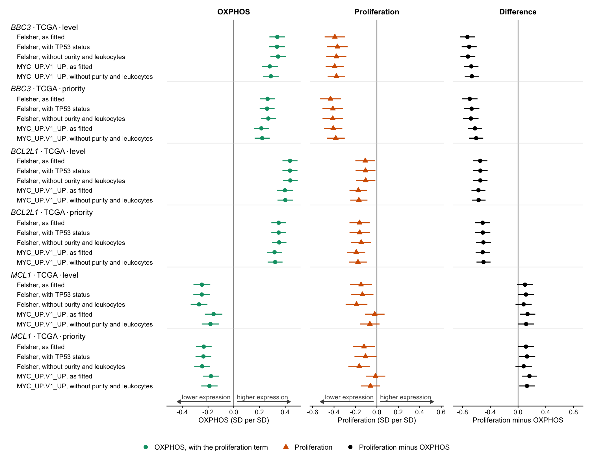

**What this is.** One section per layout of Fig. 4g, each starting on a new page, as brief 6.5 asks:

- **the panel at final size**, 178 mm wide;
- **the text** from brief section 8, finalised against the verified numbers, with that layout's citations;
- **the legend draft**, descriptive only;
- **STYLE.md metrics** for every paragraph.

The Extended Data panels that the text cites follow the three layouts.

**What is the same in every layout.**

- **The declared reading** (declaration section 7):
  - *BBC3* OPPOSITE and *BCL2L1* OPPOSITE;
  - *MCL1* NOT SEPARATED;
  - the agreement check holds in 12 of 12 cells.
- **The text rules.** Outcome row 3 applies, with the section 8 addendum. C3 holds at *m3*, so the text says "with the other two held fixed".
- **The words.** They are identical in all three layouts. **Only the citations change, and a citation that differs from layout 1's is set in bold.**
- **The metrics.** They do not depend on the citations, so the table is the same on every page.

**The record.**

- **Source:** `docs/2026-11-03_e48_result.md`. Part 4 is this text, and its section 4.1 says what changed from the brief's drafts and why.
- **The run:** verified 33 of 33 digests and 175 of 175 assertions, built 2026-11-03 01:14:04 GMT.

**How the metrics are counted.** Words are whitespace tokens containing a letter or digit. Figure citations in parentheses and reference numbers are not counted.

**Decisions for the author.**

1. The layout. If it is layout 3, decide whether 4h and 4i stay in the main figure.
2. The choices marked "the author's call" in the result note, 4.1:
   - abstract sentence 11;
   - the clinical opening sentence;
   - the 9-word kept sentence;
   - "consequences" in the mouse paragraph;
   - the abstract and closing *MCL1* sentences.
3. The optional sentences.
4. Whether S-1 enters the paper.



# Layout 1: two scores

{width=178mm}

## The text, with layout 1's citations

**Abstract, sentence 8, with the *MCL1* sentence the addendum requires.** Extending this relationship to 4,081 human breast tumours[8,9], OXPHOS and proliferation had opposite associations with *BBC3* and *BCL2L1*, encoding PUMA and BCL-xL, when modelled together with MYC activity, OXPHOS tracking *BCL2L1* more steeply than *BBC3*. The association of proliferation with *MCL1* was negative in one cohort and positive in the other. [Optional: The association of MYC activity with *BBC3* and *BCL2L1* depended on how much proliferation its score carried.]

**Abstract, sentence 11.** Together, these findings establish an apoptotic constraint on MYC-driven transformation and reveal that, in human breast tumours, OXPHOS is linked to apoptotic regulator expression and treatment response separably from proliferation.

**Mouse Fig. 4 paragraph, last sentence (unchanged).** Consequently, human tumours sustaining high OXPHOS were predicted to carry raised BCL-xL alongside raised PUMA, distinguishable from the consequences of the proliferation that OXPHOS also supports.

**The separation paragraph.** In tumours, however, OXPHOS rises with both MYC activity and proliferation, so their associations can only be interpreted once the three are separated. In TCGA-BRCA (n = 938) and SCAN-B (n = 3,143), OXPHOS was scored as subunit expression and as its priority within the mitochondrial programme, as in the mouse gland (Fig. 1e). OXPHOS correlated moderately with proliferation and with the reference MYC activity score (Spearman ρ = 0.23–0.43; Fig. 4g and Extended Data Fig. Xa). The reference score tracked proliferation more closely, making MYC activity the axis least separable from proliferation (ρ = 0.61–0.70; Extended Data Fig. Xa). We therefore modelled *BBC3*, *BCL2L1* and *MCL1* expression on all three together, adjusting for intrinsic subtype in both cohorts and for tumour purity and leukocyte fraction in TCGA-BRCA. With the other two held fixed, higher OXPHOS was associated with higher *BBC3* and *BCL2L1* and with lower *MCL1*, in both cohorts and on both measures (Fig. 4g and Extended Data Fig. Xd). Proliferation had associations opposite to those of OXPHOS with *BBC3* and *BCL2L1*, being associated with lower expression of both at fixed OXPHOS and MYC activity (Fig. 4g). Proliferation was associated with lower *MCL1* expression in TCGA-BRCA and with higher *MCL1* expression in SCAN-B (Fig. 4g). [Optional: Across the nine other BCL-2 family genes, OXPHOS and proliferation had opposite associations with three, *BAD*, *BCL2L11* and *BCL2*, in both cohorts and on both measures (Extended Data Fig. Xd).] The association of MYC activity with *BBC3* and *BCL2L1* accordingly depended on how much proliferation its score carried, the four scores examined correlating with proliferation at ρ = 0.41–0.84 (Extended Data Fig. Xa,c). [Optional: On the MYC activity score least entangled with proliferation, the association of MYC activity with each of the three genes had the same sign as that of OXPHOS (Extended Data Fig. Xc).] The correlation of OXPHOS with proliferation therefore concealed opposite associations of the two with *BBC3* and *BCL2L1*.

**The OXPHOS-side paragraph. The two co-amplification sentences wait on brief section 9 and are not shown.** Of the genes that rose with OXPHOS, *BCL2L1* did so more steeply than *BBC3* in both cohorts and on both measures, with the other two held fixed (Extended Data Fig. Xb). This resembled the mouse tumours in which high OXPHOS persisted only alongside Bcl-xL (Fig. 3h,i). A similar state has been described in quiescent, chemotherapy-persistent triple-negative breast cancer cells, in which high OXPHOS accompanies dependence on BCL-xL[26].

**The clinical paragraph, edited sentences only.** Having separated OXPHOS from proliferation on *BBC3* and *BCL2L1*, we next asked whether the two are also separable in their association with chemotherapy response. Additional adjustment for MYC activity, and then for the mean expression of *BCL2L1* and *MCL1*, did not materially alter the OXPHOS–response association (pooled odds ratios 0.87 and 0.88). The transcriptional coupling of OXPHOS and proliferation therefore concealed a clinically relevant distinction.

**The closing paragraph, its human sentences.** In human breast tumours, OXPHOS and proliferation, although correlated, had opposite associations with *BBC3*, *BCL2L1* and chemotherapy response, whilst the association of MYC activity with both genes depended on how much proliferation its score carried. The association of proliferation with *MCL1* was negative in one cohort and positive in the other.

**Methods.** The proliferation coefficients are a post hoc characterisation of a declared covariate, recovered from the saved model fits without refitting. Each difference between the proliferation and OXPHOS coefficients was computed within one model as a linear contrast. Its variance was taken from the full coefficient covariance matrix, with a t-based 95% confidence interval on the residual degrees of freedom. That *BCL2L1* rose more steeply than *BBC3* was assessed on 2,000 paired bootstrap resamples of tumours, refitting both gene models on each resample. The reference MYC activity score correlated with proliferation at ρ = 0.61–0.70, a range in which the two are not cleanly separable, whereas OXPHOS correlated with proliferation at ρ = 0.23–0.42. Variance inflation factors were 1.06–1.19 for OXPHOS, 1.35–1.60 for MYC activity and 1.66–1.72 for proliferation. [Optional: In TCGA-BRCA, the models were also refitted with TP53 mutation status added and, separately, without tumour purity and leukocyte fraction, as in SCAN-B.] This analysis was post hoc, and the directions of the proliferation coefficients could already be inferred from previously reported coefficients for MYC activity. Their confidence intervals and the within-model differences were computed under a reading rule fixed before any of them was examined.

## Legend draft

*Legend draft* (118 words). Associations of OXPHOS and proliferation with BBC3 (PUMA), BCL2L1 (BCL-xL) and MCL1 expression in TCGA-BRCA (n = 938) and SCAN-B (n = 3,143). Coefficients (SD per SD of each score) are from linear models of each gene on OXPHOS, MYC activity and intrinsic subtype, with tumour purity and leukocyte fraction in TCGA-BRCA; variables are rank-normalised within each cohort. OXPHOS was scored as subunit expression (level) or as its priority within the mitochondrial programme (priority). Open circles, OXPHOS without the proliferation term; filled circles, OXPHOS with it; triangles, proliferation. Left, Spearman correlation of OXPHOS with proliferation. Right, the proliferation coefficient minus the OXPHOS coefficient within the same model, with its 95% confidence interval from the model covariance. Bars, 95% confidence intervals.

STYLE.md does not yet cover legends (its section 9), so only their word counts are given.

## STYLE.md metrics

| paragraph | sentences | words | mean | median | range | under 20 | under 12 | em-dashes |
|:------------------------------------------|--------:|-----:|-----:|------:|--------:|---------:|-------:|-------:|
| Abstract, sentence 8 | 2 | 51 | 25.5 | 25.5 | 16–35 | 1 of 2 | 0 | 0 |
| Abstract, sentence 8, with optional | 3 | 68 | 22.7 | 17 | 16–35 | 2 of 3 | 0 | 0 |
| Abstract, sentence 11 | 1 | 30 | 30.0 | 30 | 30–30 | 0 of 1 | 0 | 0 |
| Mouse Fig. 4, last sentence | 1 | 26 | 26.0 | 26 | 26–26 | 0 of 1 | 0 | 0 |
| Separation paragraph | 10 | 223 | 22.3 | 24 | 15–28 | 4 of 10 | 0 | 0 |
| Separation paragraph, with optional | 12 | 277 | 23.1 | 25.5 | 15–28 | 4 of 12 | 0 | 0 |
| OXPHOS-side paragraph | 3 | 61 | 20.3 | 21 | 13–27 | 1 of 3 | 0 | 0 |
| Clinical, edited sentences | 3 | 65 | 21.7 | 24 | 13–28 | 1 of 3 | 0 | 0 |
| Closing, human sentences | 2 | 51 | 25.5 | 25.5 | 16–35 | 1 of 2 | 0 | 0 |
| Methods | 8 | 169 | 21.1 | 21 | 15–29 | 2 of 8 | 0 | 0 |
| Methods, with optional | 9 | 192 | 21.3 | 22 | 15–29 | 2 of 9 | 0 | 0 |

No sentence is under 12 words. There are no em-dashes, no serial commas and no colons in the text.



# Layout 2: three scores

{width=178mm}

## The text, with layout 2's citations

**Abstract, sentence 8, with the *MCL1* sentence the addendum requires.** Extending this relationship to 4,081 human breast tumours[8,9], OXPHOS and proliferation had opposite associations with *BBC3* and *BCL2L1*, encoding PUMA and BCL-xL, when modelled together with MYC activity, OXPHOS tracking *BCL2L1* more steeply than *BBC3*. The association of proliferation with *MCL1* was negative in one cohort and positive in the other. [Optional: The association of MYC activity with *BBC3* and *BCL2L1* depended on how much proliferation its score carried.]

**Abstract, sentence 11.** Together, these findings establish an apoptotic constraint on MYC-driven transformation and reveal that, in human breast tumours, OXPHOS is linked to apoptotic regulator expression and treatment response separably from proliferation.

**Mouse Fig. 4 paragraph, last sentence (unchanged).** Consequently, human tumours sustaining high OXPHOS were predicted to carry raised BCL-xL alongside raised PUMA, distinguishable from the consequences of the proliferation that OXPHOS also supports.

**The separation paragraph.** In tumours, however, OXPHOS rises with both MYC activity and proliferation, so their associations can only be interpreted once the three are separated. In TCGA-BRCA (n = 938) and SCAN-B (n = 3,143), OXPHOS was scored as subunit expression and as its priority within the mitochondrial programme, as in the mouse gland (Fig. 1e). OXPHOS correlated moderately with proliferation and with the reference MYC activity score (Spearman ρ = 0.23–0.43; Fig. 4g and Extended Data Fig. Xa). The reference score tracked proliferation more closely, making MYC activity the axis least separable from proliferation (ρ = 0.61–0.70; **Fig. 4g**). We therefore modelled *BBC3*, *BCL2L1* and *MCL1* expression on all three together, adjusting for intrinsic subtype in both cohorts and for tumour purity and leukocyte fraction in TCGA-BRCA. With the other two held fixed, higher OXPHOS was associated with higher *BBC3* and *BCL2L1* and with lower *MCL1*, in both cohorts and on both measures (Fig. 4g and Extended Data Fig. Xd). Proliferation had associations opposite to those of OXPHOS with *BBC3* and *BCL2L1*, being associated with lower expression of both at fixed OXPHOS and MYC activity (Fig. 4g). Proliferation was associated with lower *MCL1* expression in TCGA-BRCA and with higher *MCL1* expression in SCAN-B (Fig. 4g). [Optional: Across the nine other BCL-2 family genes, OXPHOS and proliferation had opposite associations with three, *BAD*, *BCL2L11* and *BCL2*, in both cohorts and on both measures (Extended Data Fig. Xd).] The association of MYC activity with *BBC3* and *BCL2L1* accordingly depended on how much proliferation its score carried, the four scores examined correlating with proliferation at ρ = 0.41–0.84 (**Fig. 4g and Extended Data Fig. Xa,c**). [Optional: On the MYC activity score least entangled with proliferation, the association of MYC activity with each of the three genes had the same sign as that of OXPHOS (Extended Data Fig. Xc).] The correlation of OXPHOS with proliferation therefore concealed opposite associations of the two with *BBC3* and *BCL2L1*.

**The OXPHOS-side paragraph. The two co-amplification sentences wait on brief section 9 and are not shown.** Of the genes that rose with OXPHOS, *BCL2L1* did so more steeply than *BBC3* in both cohorts and on both measures, with the other two held fixed (Extended Data Fig. Xb). This resembled the mouse tumours in which high OXPHOS persisted only alongside Bcl-xL (Fig. 3h,i). A similar state has been described in quiescent, chemotherapy-persistent triple-negative breast cancer cells, in which high OXPHOS accompanies dependence on BCL-xL[26].

**The clinical paragraph, edited sentences only.** Having separated OXPHOS from proliferation on *BBC3* and *BCL2L1*, we next asked whether the two are also separable in their association with chemotherapy response. Additional adjustment for MYC activity, and then for the mean expression of *BCL2L1* and *MCL1*, did not materially alter the OXPHOS–response association (pooled odds ratios 0.87 and 0.88). The transcriptional coupling of OXPHOS and proliferation therefore concealed a clinically relevant distinction.

**The closing paragraph, its human sentences.** In human breast tumours, OXPHOS and proliferation, although correlated, had opposite associations with *BBC3*, *BCL2L1* and chemotherapy response, whilst the association of MYC activity with both genes depended on how much proliferation its score carried. The association of proliferation with *MCL1* was negative in one cohort and positive in the other.

**Methods.** The proliferation coefficients are a post hoc characterisation of a declared covariate, recovered from the saved model fits without refitting. Each difference between the proliferation and OXPHOS coefficients was computed within one model as a linear contrast. Its variance was taken from the full coefficient covariance matrix, with a t-based 95% confidence interval on the residual degrees of freedom. That *BCL2L1* rose more steeply than *BBC3* was assessed on 2,000 paired bootstrap resamples of tumours, refitting both gene models on each resample. The reference MYC activity score correlated with proliferation at ρ = 0.61–0.70, a range in which the two are not cleanly separable, whereas OXPHOS correlated with proliferation at ρ = 0.23–0.42. Variance inflation factors were 1.06–1.19 for OXPHOS, 1.35–1.60 for MYC activity and 1.66–1.72 for proliferation. [Optional: In TCGA-BRCA, the models were also refitted with TP53 mutation status added and, separately, without tumour purity and leukocyte fraction, as in SCAN-B.] This analysis was post hoc, and the directions of the proliferation coefficients could already be inferred from previously reported coefficients for MYC activity. Their confidence intervals and the within-model differences were computed under a reading rule fixed before any of them was examined.

## Legend draft

*Legend draft, layout 1's legend* (118 words). Associations of OXPHOS and proliferation with BBC3 (PUMA), BCL2L1 (BCL-xL) and MCL1 expression in TCGA-BRCA (n = 938) and SCAN-B (n = 3,143). Coefficients (SD per SD of each score) are from linear models of each gene on OXPHOS, MYC activity and intrinsic subtype, with tumour purity and leukocyte fraction in TCGA-BRCA; variables are rank-normalised within each cohort. OXPHOS was scored as subunit expression (level) or as its priority within the mitochondrial programme (priority). Open circles, OXPHOS without the proliferation term; filled circles, OXPHOS with it; triangles, proliferation. Left, Spearman correlation of OXPHOS with proliferation. Right, the proliferation coefficient minus the OXPHOS coefficient within the same model, with its 95% confidence interval from the model covariance. Bars, 95% confidence intervals.

*then layout 2's addition* (27 words). As layout 1, with MYC activity added: squares, MYC activity without (open) and with (filled) the proliferation term. Second column, Spearman correlation of MYC activity with proliferation.

STYLE.md does not yet cover legends (its section 9), so only their word counts are given.

## STYLE.md metrics

| paragraph | sentences | words | mean | median | range | under 20 | under 12 | em-dashes |
|:------------------------------------------|--------:|-----:|-----:|------:|--------:|---------:|-------:|-------:|
| Abstract, sentence 8 | 2 | 51 | 25.5 | 25.5 | 16–35 | 1 of 2 | 0 | 0 |
| Abstract, sentence 8, with optional | 3 | 68 | 22.7 | 17 | 16–35 | 2 of 3 | 0 | 0 |
| Abstract, sentence 11 | 1 | 30 | 30.0 | 30 | 30–30 | 0 of 1 | 0 | 0 |
| Mouse Fig. 4, last sentence | 1 | 26 | 26.0 | 26 | 26–26 | 0 of 1 | 0 | 0 |
| Separation paragraph | 10 | 223 | 22.3 | 24 | 15–28 | 4 of 10 | 0 | 0 |
| Separation paragraph, with optional | 12 | 277 | 23.1 | 25.5 | 15–28 | 4 of 12 | 0 | 0 |
| OXPHOS-side paragraph | 3 | 61 | 20.3 | 21 | 13–27 | 1 of 3 | 0 | 0 |
| Clinical, edited sentences | 3 | 65 | 21.7 | 24 | 13–28 | 1 of 3 | 0 | 0 |
| Closing, human sentences | 2 | 51 | 25.5 | 25.5 | 16–35 | 1 of 2 | 0 | 0 |
| Methods | 8 | 169 | 21.1 | 21 | 15–29 | 2 of 8 | 0 | 0 |
| Methods, with optional | 9 | 192 | 21.3 | 22 | 15–29 | 2 of 9 | 0 | 0 |

No sentence is under 12 words. There are no em-dashes, no serial commas and no colons in the text.



# Layout 3: the whole argument in one panel

{width=178mm}

## The text, with layout 3's citations

**Abstract, sentence 8, with the *MCL1* sentence the addendum requires.** Extending this relationship to 4,081 human breast tumours[8,9], OXPHOS and proliferation had opposite associations with *BBC3* and *BCL2L1*, encoding PUMA and BCL-xL, when modelled together with MYC activity, OXPHOS tracking *BCL2L1* more steeply than *BBC3*. The association of proliferation with *MCL1* was negative in one cohort and positive in the other. [Optional: The association of MYC activity with *BBC3* and *BCL2L1* depended on how much proliferation its score carried.]

**Abstract, sentence 11.** Together, these findings establish an apoptotic constraint on MYC-driven transformation and reveal that, in human breast tumours, OXPHOS is linked to apoptotic regulator expression and treatment response separably from proliferation.

**Mouse Fig. 4 paragraph, last sentence (unchanged).** Consequently, human tumours sustaining high OXPHOS were predicted to carry raised BCL-xL alongside raised PUMA, distinguishable from the consequences of the proliferation that OXPHOS also supports.

**The separation paragraph.** In tumours, however, OXPHOS rises with both MYC activity and proliferation, so their associations can only be interpreted once the three are separated. In TCGA-BRCA (n = 938) and SCAN-B (n = 3,143), OXPHOS was scored as subunit expression and as its priority within the mitochondrial programme, as in the mouse gland (Fig. 1e). OXPHOS correlated moderately with proliferation and with the reference MYC activity score (Spearman ρ = 0.23–0.43; Fig. 4g and Extended Data Fig. Xa). The reference score tracked proliferation more closely, making MYC activity the axis least separable from proliferation (ρ = 0.61–0.70; Extended Data Fig. Xa). We therefore modelled *BBC3*, *BCL2L1* and *MCL1* expression on all three together, adjusting for intrinsic subtype in both cohorts and for tumour purity and leukocyte fraction in TCGA-BRCA. With the other two held fixed, higher OXPHOS was associated with higher *BBC3* and *BCL2L1* and with lower *MCL1*, in both cohorts and on both measures (Fig. 4g and Extended Data Fig. Xd). Proliferation had associations opposite to those of OXPHOS with *BBC3* and *BCL2L1*, being associated with lower expression of both at fixed OXPHOS and MYC activity (**Fig. 4g and Extended Data Fig. Xd**). Proliferation was associated with lower *MCL1* expression in TCGA-BRCA and with higher *MCL1* expression in SCAN-B (**Fig. 4g and Extended Data Fig. Xd**). [Optional: Across the nine other BCL-2 family genes, OXPHOS and proliferation had opposite associations with three, *BAD*, *BCL2L11* and *BCL2*, in both cohorts and on both measures (Extended Data Fig. Xd).] The association of MYC activity with *BBC3* and *BCL2L1* accordingly depended on how much proliferation its score carried, the four scores examined correlating with proliferation at ρ = 0.41–0.84 (Extended Data Fig. Xa,c). [Optional: On the MYC activity score least entangled with proliferation, the association of MYC activity with each of the three genes had the same sign as that of OXPHOS (Extended Data Fig. Xc).] The correlation of OXPHOS with proliferation therefore concealed opposite associations of the two with *BBC3* and *BCL2L1*.

**The OXPHOS-side paragraph. The two co-amplification sentences wait on brief section 9 and are not shown.** Of the genes that rose with OXPHOS, *BCL2L1* did so more steeply than *BBC3* in both cohorts and on both measures, with the other two held fixed (Extended Data Fig. Xb). This resembled the mouse tumours in which high OXPHOS persisted only alongside Bcl-xL (Fig. 3h,i). A similar state has been described in quiescent, chemotherapy-persistent triple-negative breast cancer cells, in which high OXPHOS accompanies dependence on BCL-xL[26].

**The clinical paragraph, edited sentences only.** Having separated OXPHOS from proliferation on *BBC3* and *BCL2L1*, we next asked whether the two are also separable in their association with chemotherapy response. Additional adjustment for MYC activity, and then for the mean expression of *BCL2L1* and *MCL1*, did not materially alter the OXPHOS–response association (pooled odds ratios 0.87 and 0.88). The transcriptional coupling of OXPHOS and proliferation therefore concealed a clinically relevant distinction.

**The closing paragraph, its human sentences.** In human breast tumours, OXPHOS and proliferation, although correlated, had opposite associations with *BBC3*, *BCL2L1* and chemotherapy response, whilst the association of MYC activity with both genes depended on how much proliferation its score carried. The association of proliferation with *MCL1* was negative in one cohort and positive in the other.

**Methods.** The proliferation coefficients are a post hoc characterisation of a declared covariate, recovered from the saved model fits without refitting. Each difference between the proliferation and OXPHOS coefficients was computed within one model as a linear contrast. Its variance was taken from the full coefficient covariance matrix, with a t-based 95% confidence interval on the residual degrees of freedom. That *BCL2L1* rose more steeply than *BBC3* was assessed on 2,000 paired bootstrap resamples of tumours, refitting both gene models on each resample. The reference MYC activity score correlated with proliferation at ρ = 0.61–0.70, a range in which the two are not cleanly separable, whereas OXPHOS correlated with proliferation at ρ = 0.23–0.42. Variance inflation factors were 1.06–1.19 for OXPHOS, 1.35–1.60 for MYC activity and 1.66–1.72 for proliferation. [Optional: In TCGA-BRCA, the models were also refitted with TP53 mutation status added and, separately, without tumour purity and leukocyte fraction, as in SCAN-B.] This analysis was post hoc, and the directions of the proliferation coefficients could already be inferred from previously reported coefficients for MYC activity. Their confidence intervals and the within-model differences were computed under a reading rule fixed before any of them was examined.

## Legend draft

*Legend draft, verbatim from the script* (106 words). Top, the BCL-2 family as in layout 1, OXPHOS level only. Middle, pathological complete response in three neoadjuvant cohorts and their pooled estimate: odds ratios per within-cohort SD from logistic models, OXPHOS without (open) and with (filled) the proliferation term, and proliferation (triangles); right, the ratio of the two odds ratios within the same model. Bottom, breast-cancer-specific survival in ER-positive (IHC) METABRIC: hazard ratios from Cox models with proliferation; right, the ratio of hazard ratios. The BCL-2 family panel holds MYC activity fixed; the outcome panels come from models without a MYC activity term. The METABRIC correlation is over all 1,981 patients. Bars, 95% confidence intervals.

**A flag for layout 3.** The facet title reads "BCL-2 family, OXPHOS level", and this legend uses "the BCL-2 family" twice for *BBC3*, *BCL2L1* and *MCL1*. The section 8 addendum keeps that phrase out of the text for the three read genes. A legend variant that follows it: "Top, *BBC3*, *BCL2L1* and *MCL1* as in layout 1, OXPHOS level only." and "The top panel holds MYC activity fixed". Changing the facet title is a re-render, which is a display-only task and the author's call.

STYLE.md does not yet cover legends (its section 9), so only their word counts are given.

## STYLE.md metrics

| paragraph | sentences | words | mean | median | range | under 20 | under 12 | em-dashes |
|:------------------------------------------|--------:|-----:|-----:|------:|--------:|---------:|-------:|-------:|
| Abstract, sentence 8 | 2 | 51 | 25.5 | 25.5 | 16–35 | 1 of 2 | 0 | 0 |
| Abstract, sentence 8, with optional | 3 | 68 | 22.7 | 17 | 16–35 | 2 of 3 | 0 | 0 |
| Abstract, sentence 11 | 1 | 30 | 30.0 | 30 | 30–30 | 0 of 1 | 0 | 0 |
| Mouse Fig. 4, last sentence | 1 | 26 | 26.0 | 26 | 26–26 | 0 of 1 | 0 | 0 |
| Separation paragraph | 10 | 223 | 22.3 | 24 | 15–28 | 4 of 10 | 0 | 0 |
| Separation paragraph, with optional | 12 | 277 | 23.1 | 25.5 | 15–28 | 4 of 12 | 0 | 0 |
| OXPHOS-side paragraph | 3 | 61 | 20.3 | 21 | 13–27 | 1 of 3 | 0 | 0 |
| Clinical, edited sentences | 3 | 65 | 21.7 | 24 | 13–28 | 1 of 3 | 0 | 0 |
| Closing, human sentences | 2 | 51 | 25.5 | 25.5 | 16–35 | 1 of 2 | 0 | 0 |
| Methods | 8 | 169 | 21.1 | 21 | 15–29 | 2 of 8 | 0 | 0 |
| Methods, with optional | 9 | 192 | 21.3 | 22 | 15–29 | 2 of 9 | 0 | 0 |

No sentence is under 12 words. There are no em-dashes, no serial commas and no colons in the text.



# The Extended Data panels the text cites

These are reproduced at final size, each with its legend draft verbatim from the script. Xa to Xd are placeholder letters.

## ED-a: the scores' correlations

Cited as: Extended Data Fig. Xa.

{width=178mm}

*Legend draft* (66 words). Spearman correlations among the two OXPHOS scores, four MYC activity scores and proliferation in TCGA-BRCA (n = 938) and SCAN-B (n = 3,143), shaded by band (below 0.60; 0.60 to 0.80; 0.80 or above). Each MYC activity score is labelled with the percentage of its genes in proliferation gene sets (Hallmark E2F targets and G2M checkpoint). Right, the reference MYC activity score against proliferation in three neoadjuvant cohorts.

## ED-b: *BCL2L1* against *BBC3*

Cited as: Extended Data Fig. Xb.

{width=178mm}

*Legend draft* (51 words). OXPHOS coefficients for BCL2L1 and BBC3 with MYC activity held fixed, without (open) and with (filled) the proliferation term, in TCGA-BRCA (n = 938) and SCAN-B (n = 3,143), and the difference between them, with 95% percentile intervals from 2,000 paired bootstrap resamples of tumours. Bars on the coefficients, model-based 95% confidence intervals.

## ED-c: MYC activity on four scores

Cited as: Extended Data Fig. Xc.

{width=178mm}

*Legend draft* (70 words). MYC activity coefficients for BBC3, BCL2L1 and MCL1 on four MYC activity scores, ordered by the percentage of their genes in proliferation gene sets, without (open) and with (filled) the proliferation term, with the proliferation coefficient (triangles), in TCGA-BRCA (n = 938) and SCAN-B (n = 3,143). Faded points are cells in which the score and proliferation correlate at 0.80 or more; they are shown and not interpreted. Bars, 95% confidence intervals.

## ED-d: all twelve genes, three coefficients

Cited as: Extended Data Fig. Xd.

{width=178mm}

*Legend draft* (72 words). All twelve BCL-2 family genes: coefficients of OXPHOS (circles), proliferation (triangles) and MYC activity (squares), each with the other two held fixed, and the proliferation minus OXPHOS difference, on the reference MYC activity score (left) and the score with least overlap with proliferation gene sets (right), in TCGA-BRCA (n = 938) and SCAN-B (n = 3,143). Bold, the three genes read under the declared rule. No correction for multiple genes. Bars, 95% confidence intervals.

## S-1: the sensitivities C1 and C4

Cited as: none. Whether S-1 enters the paper is the author's call (declaration 12.3).

{width=178mm}

*Legend draft* (56 words). Sensitivity analyses in TCGA-BRCA (n = 938): OXPHOS and proliferation coefficients and their difference for BBC3, BCL2L1 and MCL1, as fitted, with TP53 mutation status added, and without tumour purity and leukocyte fraction (the SCAN-B covariate set), on the reference MYC activity score and the score with least overlap with proliferation gene sets. Bars, 95% confidence intervals.
