**What this is.** Fig. 4g as E50 draws it, at final size (87.6 mm wide), with the text, the legend draft and the STYLE.md metrics, followed by the Extended Data panels.

- **E50 follows the author's amendment** (`docs/2026-11-03_E50_display_amendment.md`):
  - no grey anywhere;
  - Fig. 1g's palette;
  - 4g, ED-e and ED-f in Fig. 1g's style, with no annotation columns and no dots;
  - ED-g and ED-h re-coloured.
- **The binding code, the signature signs, the § marks and any protein names** are the author's, added in Illustrator.
- **The panels shown are the PNG previews.** The PDF and SVG beside them in `docs/figures/` are the files for Illustrator, with live Helvetica text.

**THE TEXT IS NOT YET AMENDED.**

- **What it is:** E49's result note, Part 4, unchanged (`4fd661b`).
- **Why:** the amendment says the STOP 3 rulings on the text still stand. Those rulings (items 1 to 6, amendments A to E) are not in the repo and did not reach this session.
- **When they arrive:** the sentences are edited in their one source, E49's `pack_text.py`, and this pack is regenerated.
- **What has already changed:** only the legend drafts, as E50 changed them.

**The record.**

- **E50 is verified:** 116 of 116 assertions, and 11 of 12 saved elements by digest. The twelfth differs only in one label's wording.
  - **All comparable figure files match the checksums committed before the run** (`eae8ef5`).
  - **The details:** `docs/2026-11-03_e50_result.md`.
- **Nothing new is computed.** Every number drawn was stored by E49 (`4fd661b`).

**The palette is Fig. 1g's source, not the measured values.** Item 2 puts the source first.

| anchor | Fig. 1g's source (used) | measured from the Fig. 1 PDF (not used) |
|---|---|---|
| negative limit | `#4A3525` | `#462915` |
| zero | `#FAFAFA` | `#F9F9F9` |
| positive limit | `#2A8A6D` | `#318866` |

Fig. 1g's scale interpolates in CIELAB, and E50 follows it.

**Choices the amendment left open** (E50's pre-run note, section 3):

- **One scale for 4g, ED-e and ED-f, ±0.6.** ED-e alone would be ±0.5.
- **ED-g's scale is ±0.9,** set by its "proliferation minus OXPHOS" cells. ED-h stays at ±0.7 for the raw correlations and ±0.6 for the adjusted coefficients.
- **The gap before the Signature row** is twice the group gap.
- **Ink is black, or white where white reads better:** 9 of 288 cells.
- **The group names and the bar's title are 5 pt** (item 3's two sizes). Fig. 1g sets them at 6 pt.

**One qualification found after E49 ran** (E49 result, Part 2 H2; AD HOC arithmetic, not declared).

- **The issue.** Part of the signature's proliferation coefficient can be inherited from its selection rule. The rule chose genes by their correlation with OXPHOS at fixed proliferation.
- **How much.** At the extreme, up to about half of the coefficient on 4g's model in TCGA, and a third in SCAN-B.
- **What remains.** The remainder is negative in every cell, but it has no interval.
- **MYC activity's coefficient is unaffected.**
- **The test** would take the next free script number, `E51` or later.

**How the metrics are counted.** Words are whitespace tokens containing a letter or digit. Figure citations in parentheses and reference numbers are not counted.

**Decisions for the author.**

1. **Supply the STOP 3 rulings** so that the text can be amended.
2. **The palette:** Fig. 1g's source, as drawn, or the measured values.
3. **The open choices above.**
4. **Whether to declare the H2 test.**
5. **The proposed legend additions** (E49 result note, 4.3), still marked as proposed below.



# Fig. 4g (E50)

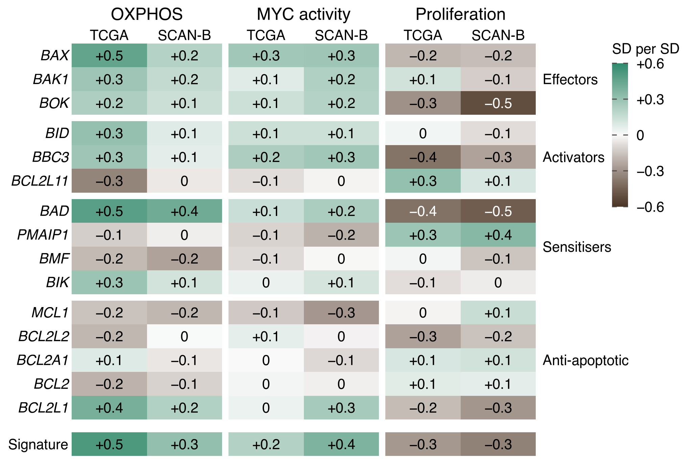{width=87.6mm}

## The text, as committed in E49's result note, Part 4 (not yet amended)

**Abstract: the human sentences.** Extending this relationship to 4,081 human breast tumours[8,9], an OXPHOS-associated BCL-2 family signature showed BCL-xL rising more steeply than PUMA. MYC activity, once separated from proliferation, was associated with the same signature, whereas proliferation was associated with the opposite when OXPHOS was held fixed.

**Mouse Fig. 4 paragraph: last sentence (unchanged).** Consequently, established human tumours with high OXPHOS and MYC activity were predicted to carry raised pro-apoptotic signalling restrained by BCL-xL, distinct from the consequences of proliferation.

**The signature paragraph.** In tumours, however, OXPHOS rises with both MYC activity and proliferation, so their associations can only be interpreted once the three are separated. In TCGA-BRCA (n = 938) and SCAN-B (n = 3,143) we therefore modelled each BCL-2 family gene on all three together, adjusting for intrinsic subtype (Fig. 4g). Two of four MYC activity scores, including the widely used Hallmark set, correlated with proliferation too closely to be separated from it, so we used one containing few proliferation genes (Extended Data Fig. Xa). Six of the twelve BH3-only and anti-apoptotic genes, the mitochondrial members most closely associated with OXPHOS, formed a signature (Fig. 4g). BCL2L1, encoding BCL-xL, rose with the activators BBC3 and BID and the sensitisers BAD and BIK, whilst MCL1 fell. Outside the signature, BCL2L11, BMF and BCL2 also fell with OXPHOS in both cohorts (Fig. 4g). Because the signature was defined by OXPHOS, that association is descriptive, whereas its associations with proliferation and MYC activity played no part in its definition. Although proliferation correlated with OXPHOS (ρ = 0.23–0.42; Extended Data Fig. Xa), the signature did not follow it (Extended Data Fig. Xh), and at fixed OXPHOS and MYC activity higher proliferation went with lower signature expression (Fig. 4g). On the score with few proliferation genes, and on a second, equally separable score, MYC activity went with the signature in the same direction as OXPHOS, whereas the other two scores showed this less (Fig. 4g and Extended Data Fig. Xj). OXPHOS and MYC activity therefore went with the signature in one direction, and proliferation in the other. The effectors BAX, BAK1 and BOK, outside the signature, rose with OXPHOS and MYC activity in both cohorts, whilst proliferation went with lower BAX and BOK (Fig. 4g).

**The balance paragraph.** Within the signature, BCL2L1 rose more steeply with OXPHOS than BBC3, encoding PUMA, in both cohorts (Extended Data Fig. Xb). This is the reverse of the MYC-expressing gland, in which PUMA rose relative to BCL-xL with OXPHOS priority (Fig. 1i; Extended Data Fig. Xk), and resembles the mouse tumours that sustained high OXPHOS only alongside Bcl-xL (Fig. 3h,i). BAD rose most steeply of all (Fig. 4g), but BAD neutralises BCL-xL only when unphosphorylated, and survival signals phosphorylate it and hold it away from BCL-xL[Zha]. Its expression therefore does not measure its activity, unlike that of PUMA, which is controlled mainly through transcription[Nakano].

**The MCL1 paragraph.** MCL1 fell as BCL-xL rose, so BCL-xL was the only one of the two main guardians to rise alongside PUMA, which binds both[Chen]. MCL1's reported support of respiration in breast cancer stem cells depends on a mitochondrial function separable from its anti-apoptotic role[27]. This suggests that tumours with high OXPHOS rely on BCL-xL rather than MCL1, like persistent OXPHOS-high triple-negative breast cancer cells, which depend on BCL-xL and are insensitive to MCL1 inhibition[26].

**The clinical paragraph: edited sentences only.** Having separated OXPHOS from proliferation on the BCL-2 family, we next asked whether the two are also separable in their association with chemotherapy response. Additional adjustment for MYC activity, and then for the mean expression of BCL2L1 and MCL1, did not materially alter the OXPHOS–response association (pooled odds ratios 0.87 and 0.88). The transcriptional coupling of OXPHOS and proliferation therefore concealed a clinically relevant distinction.

**The closing paragraph: its human sentence.** In human breast tumours, OXPHOS and MYC activity were associated with a BCL-2 family signature in which BCL-xL outpaced PUMA, whereas proliferation ran the other way, on this signature as on chemotherapy response.

**Methods notes (the signature's definition is E47 declaration 4a.7, item 5, unchanged and not re-measured here).** The effectors BAX, BAK1 and BOK were fitted for comparison with the groups of Fig. 1g and were not added to the signature. Binding of BCL-xL and MCL1 by each BH3-only protein was taken from published peptide affinities and is shown only where the source states it[Chen]. This analysis was post hoc, and the signature's proliferation coefficient had been seen in an earlier analysis before it was declared; no reading rule was applied, and every coefficient is reported.

## Legend draft

*Verbatim from E50* (177 words). Associations of OXPHOS level, MYC activity and proliferation with the expression of fifteen BCL-2 family genes, in the groups of Fig. 1g, in TCGA-BRCA (n = 938) and SCAN-B (n = 3,143). Each row is one linear model of the gene's expression on OXPHOS, MYC activity and proliferation, with intrinsic subtype, and with tumour purity and leukocyte fraction in TCGA-BRCA; each coefficient is in SD per SD with the other two held fixed, and every variable is rank-normalised within each cohort. MYC activity is scored on MYC_UP.V1_UP, a score with few proliferation genes; the other MYC activity scores are shown in Extended Data. Left, binding of BCL-xL and MCL1 by BH3-only proteins, from Chen et al. (2005): filled, binds; open, does not; blank, not yet verified. Signature sign: the direction in which each of the six signature genes enters the signature. § BH3-only proteins whose activity is switched after translation (BAD: off by phosphorylation; BID: on by cleavage to tBID). The signature was selected for its association with OXPHOS at fixed proliferation (Methods). OXPHOS priority is shown in Extended Data.

*Proposed additions, not in the script's draft (E49 result note, 4.3)* (42 words). Proliferation went with higher BAK1 in TCGA-BRCA and lower BAK1 in SCAN-B, and with higher MCL1 in SCAN-B only. BCL2L11 (BIM) fell with OXPHOS more steeply in TCGA-BRCA than in SCAN-B. PMAIP1 (NOXA) and BCL2L11 went with higher proliferation in both cohorts.

STYLE.md does not yet cover legends (its section 9), so only their word counts are given.

## STYLE.md metrics

| paragraph | sentences | words | mean | median | range | under 20 | under 12 | em-dashes |
|:------------------------------------------|--------:|-----:|-----:|------:|--------:|---------:|-------:|-------:|
| Abstract | 2 | 44 | 22.0 | 22 | 20–24 | 0 of 2 | 0 | 0 |
| Mouse Fig. 4, last sentence | 1 | 26 | 26.0 | 26 | 26–26 | 0 of 1 | 0 | 0 |
| Signature paragraph | 11 | 257 | 23.4 | 23 | 14–34 | 4 of 11 | 0 | 0 |
| Balance paragraph | 4 | 88 | 22.0 | 21 | 16–30 | 2 of 4 | 0 | 0 |
| MCL1 paragraph | 3 | 73 | 24.3 | 23 | 20–30 | 0 of 3 | 0 | 0 |
| Clinical, edited sentences | 3 | 65 | 21.7 | 24 | 13–28 | 1 of 3 | 0 | 0 |
| Closing, human sentence | 1 | 33 | 33.0 | 33 | 33–33 | 0 of 1 | 0 | 0 |
| Methods notes | 3 | 78 | 26.0 | 24 | 23–31 | 0 of 3 | 0 | 0 |

**The three Results paragraphs together:** 18 sentences, 418 words, mean 23.2, median 23, range 14–34, 6 of 18 (33%) under 20 words. **That share is below STYLE.md's 35% floor**; no sentence was shortened for the metric.

No sentence is under 12 words or over 38. There are no em-dashes and no serial commas: each ", and" joins two clauses. The clinical sentences C1 to C3 are the brief's own.



# The Extended Data panels

Each is shown at final size, with its legend draft verbatim from the script that drew it. The letters are placeholders: a to c are E48's; e to h are E50's, which redraws E49's; i to k are E49's. E48's ED-d is superseded for the paper by ED-i, its extension.

## ED-a (E48): the scores' correlations

Cited as: Extended Data Fig. Xa, in sentences S2b and S6.

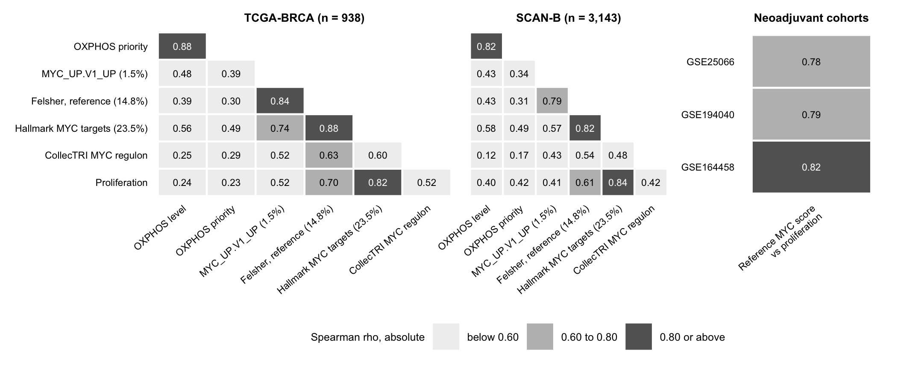{width=178mm}

*Legend draft* (66 words). Spearman correlations among the two OXPHOS scores, four MYC activity scores and proliferation in TCGA-BRCA (n = 938) and SCAN-B (n = 3,143), shaded by band (below 0.60; 0.60 to 0.80; 0.80 or above). Each MYC activity score is labelled with the percentage of its genes in proliferation gene sets (Hallmark E2F targets and G2M checkpoint). Right, the reference MYC activity score against proliferation in three neoadjuvant cohorts.

## ED-b (E48): *BCL2L1* against *BBC3*

Cited as: Extended Data Fig. Xb, in sentence B1.

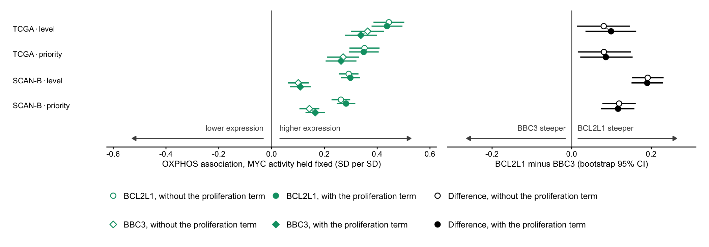{width=178mm}

*Legend draft* (51 words). OXPHOS coefficients for BCL2L1 and BBC3 with MYC activity held fixed, without (open) and with (filled) the proliferation term, in TCGA-BRCA (n = 938) and SCAN-B (n = 3,143), and the difference between them, with 95% percentile intervals from 2,000 paired bootstrap resamples of tumours. Bars on the coefficients, model-based 95% confidence intervals.



## ED-c (E48): MYC activity on four scores, three genes

Cited as: not cited in the text. ED-f sits beside it.

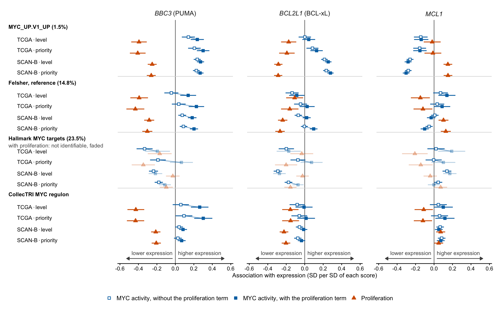{width=178mm}

*Legend draft* (70 words). MYC activity coefficients for BBC3, BCL2L1 and MCL1 on four MYC activity scores, ordered by the percentage of their genes in proliferation gene sets, without (open) and with (filled) the proliferation term, with the proliferation coefficient (triangles), in TCGA-BRCA (n = 938) and SCAN-B (n = 3,143). Faded points are cells in which the score and proliferation correlate at 0.80 or more; they are shown and not interpreted. Bars, 95% confidence intervals.



## ED-e (E50): Fig. 4g on OXPHOS priority

Cited as: not cited in the text; the 4g legend points to it.

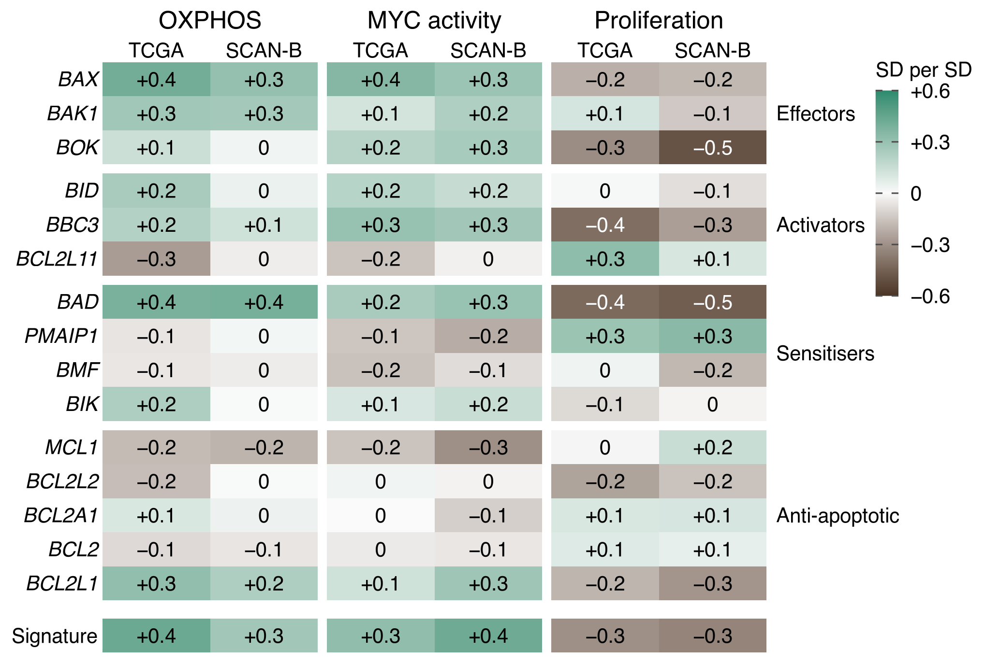{width=87.6mm}

*Legend draft* (14 words). As Fig. 4g, with OXPHOS scored as its priority within the mitochondrial programme (mitoPPS).



## ED-f (E50): Fig. 4g from the reference model

Cited as: not cited in the text; the 4g legend points to it.

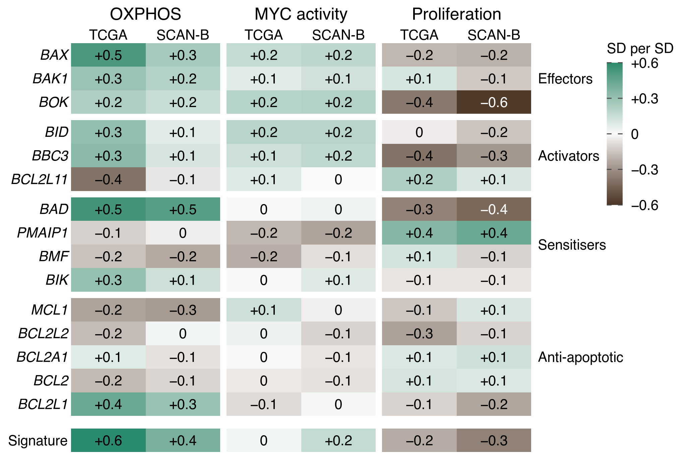{width=87.6mm}

*Legend draft* (20 words). As Fig. 4g, from models using the reference MYC activity score (Felsher), which correlates with proliferation at 0.61 to 0.70.



## ED-g (E50): the signature and its two variants, re-coloured

Cited as: not cited in the text.

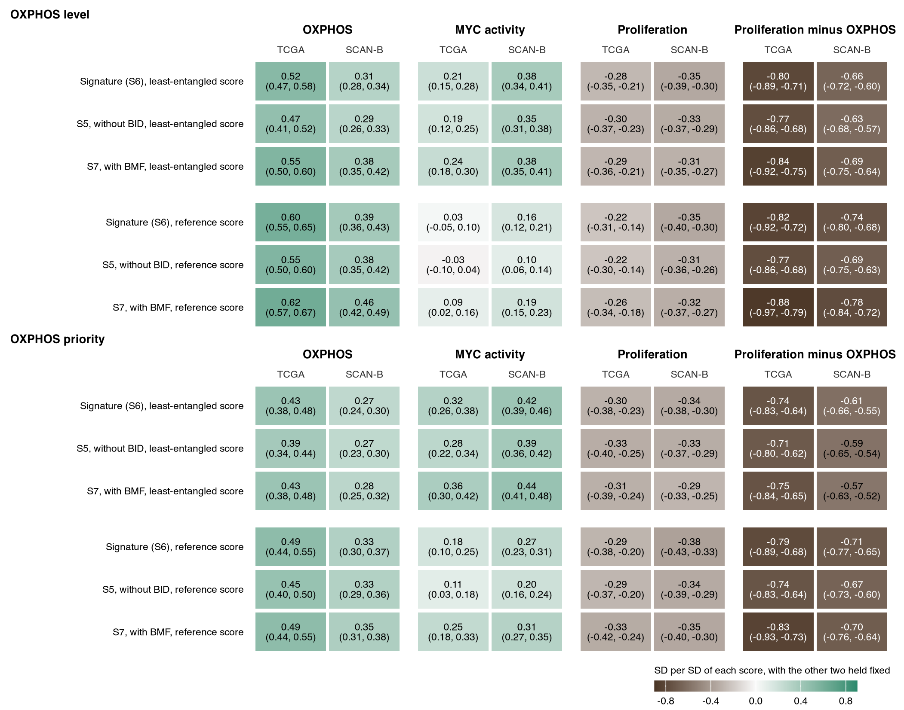{width=178mm}

*Legend draft* (71 words). The six-gene signature (S6) and its two variants, S5 (without BID) and S7 (with BMF), on the MYC activity score with few proliferation genes and on the reference score, with OXPHOS scored as level and as priority, in TCGA-BRCA (n = 938) and SCAN-B (n = 3,143). Each cell gives the coefficient (SD per SD) and its 95% confidence interval. The signature was selected for its association with OXPHOS at fixed proliferation (Methods).



## ED-h (E50): raw correlations beside the adjusted coefficients, re-coloured

Cited as: Extended Data Fig. Xh, in sentence S6.

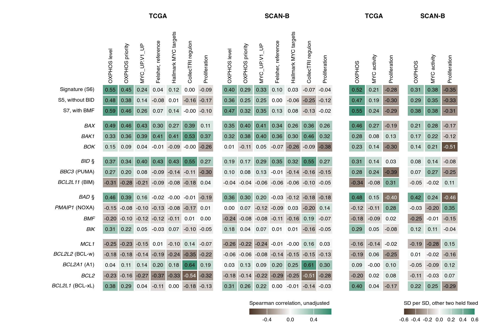{width=178mm}

*Legend draft* (53 words). Left, unadjusted Spearman correlations of the signature, its variants and fifteen BCL-2 family genes with OXPHOS (level and priority), four MYC activity scores and proliferation, in TCGA-BRCA (n = 938) and SCAN-B (n = 3,143). Right, the adjusted coefficients of Fig. 4g. The signature was selected for its association with OXPHOS at fixed proliferation (Methods).



## ED-i (E49): all fifteen genes, three coefficients and the difference

Cited as: not cited in the text.

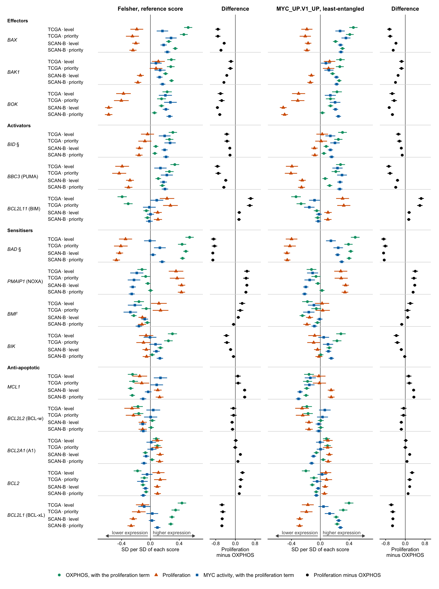{width=178mm}

*Legend draft* (81 words). Fifteen BCL-2 family genes, in the groups of Fig. 1g: coefficients of OXPHOS (circles), proliferation (triangles) and MYC activity (squares), each with the other two held fixed, and proliferation minus OXPHOS, on the reference MYC activity score (left) and the score with few proliferation genes (right), in TCGA-BRCA (n = 938) and SCAN-B (n = 3,143). § BH3-only proteins whose activity is switched after translation (BAD: off by phosphorylation; BID: on by cleavage to tBID). No correction for multiple genes. Bars, 95% confidence intervals.



## ED-j (E49): MYC activity on four scores, the signatures and the effectors

Cited as: Extended Data Fig. Xj, in sentence S7.

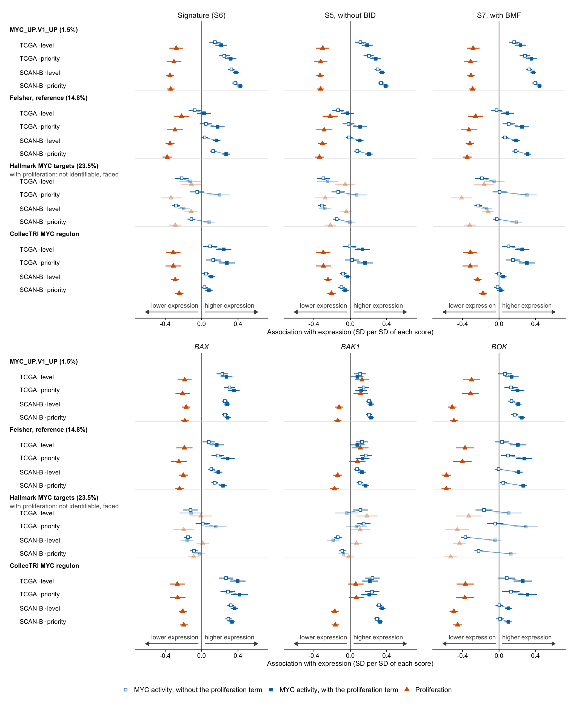{width=178mm}

*Legend draft* (76 words). MYC activity coefficients for the signature, its two variants and BAX, BAK1 and BOK on four MYC activity scores, ordered by the percentage of their genes in proliferation gene sets, without (open) and with (filled) the proliferation term, with the proliferation coefficient (triangles), in TCGA-BRCA (n = 938) and SCAN-B (n = 3,143). Faded points are cells in which the score and proliferation correlate at 0.80 or more; they are shown and not interpreted. Bars, 95% confidence intervals.



## ED-k (E49): PUMA relative to BCL-xL against OXPHOS priority

Cited as: Extended Data Fig. Xk, in sentence B2.

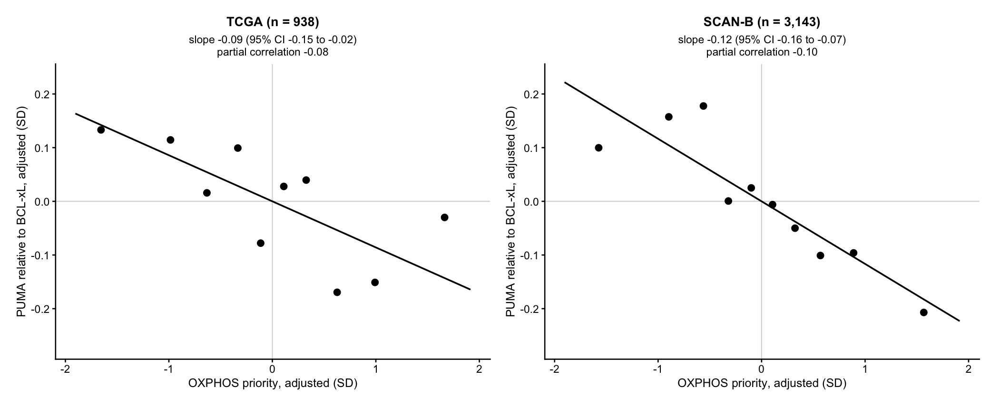{width=178mm}

*Legend draft* (61 words). BBC3 (PUMA) relative to BCL2L1 (BCL-xL) against OXPHOS priority, each adjusted for the reference MYC activity score, proliferation and intrinsic subtype (and purity and leukocyte fraction in TCGA-BRCA), in TCGA-BRCA (n = 938) and SCAN-B (n = 3,143). Points, means of the ten deciles of adjusted OXPHOS priority; line, the fitted slope, with its 95% interval from 2,000 paired bootstrap resamples of tumours.
